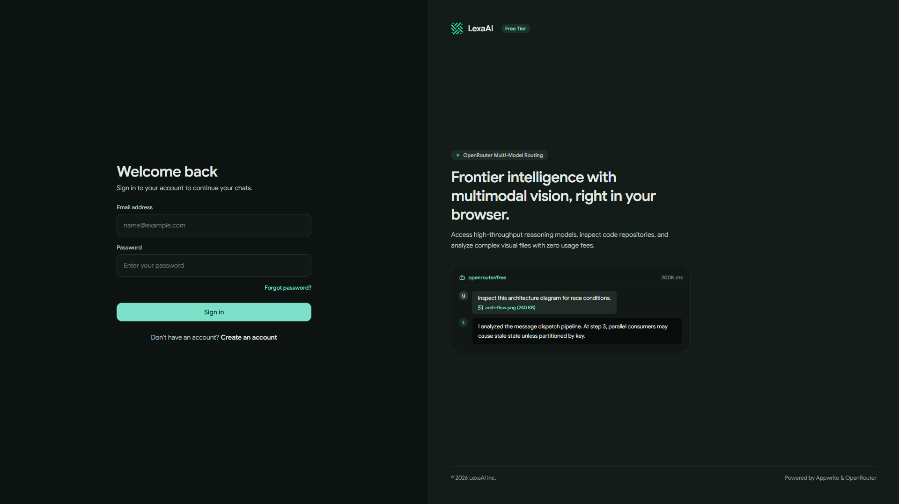

# LexaAI

**LexaAI** is an AI-powered chatbot built using **React**, **Vite**, and **Appwrite**, powered by the **OpenRouter API**. It provides a modern, fast, and interactive chat experience with support for free multimodal models, multi-file attachments, speech synthesis, chat exports, secure authentication, persistent conversations, customizable themes, and a clean UI.

## Features

- **Free Multimodal AI Conversations**: Real-time intelligent responses powered by the **OpenRouter API** with access to 100% free models (`:free`), supporting up to 1M token context windows, deep reasoning, and vision.
- **Interactive Model Selector**: Switch between curated free models directly from the prompt bar. Filter by **All**, **Vision**, **Text Only**, **1M Context**, **Coding**, or **Reasoning**, with live search and rich model capability tooltips.
- **Multi-File & Document Attachments**: Attach images (PNG, JPG, WebP), PDFs, documents, and code files (`.py`, `.js`, `.ts`, `.json`, `.csv`, `.md`, etc.) via file picker, drag-and-drop, or clipboard paste.
- **Chat & Response Export**: Export complete conversations or individual AI responses to **PDF**, **Microsoft Word (.doc)**, or **Markdown (.md)** with syntax-highlighted code and clean formatting.
- **Text-to-Speech (TTS) Voice Readout**: Listen to AI responses with natural speech synthesis, markdown text cleaning, and intuitive playback controls.
- **Code Highlighting & Snippet Download**: Syntax highlighting for 35+ programming languages, single-click code block copying, and direct code snippet download with proper file extensions.
- **Live Generation Controls**: Stop button to abort active in-flight AI generation streams and requests instantly.
- **Conversation Management**: Instant title derivation, inline conversation renaming, single chat deletion, and bulk chat history clearing with cascading Appwrite database cleanup.
- **Account & Security Settings**: Dedicated account management page to update display name, change email and password, review session information, or permanently delete accounts with safety confirmation.
- **Theme Customization**: Seamless switching between **Light**, **Dark**, and **System** default themes with persistent preferences.
- **Secure Authentication**: Complete authentication and session management powered by **Appwrite Auth**, including user registration, login, session persistence, and password reset workflows.
- **Conversation Persistence**: Chat history and embedded attachments stored securely in **Appwrite Databases** with row-level security.
- **Fast Performance & Modern UI**: Responsive, mobile-friendly interface built with **Tailwind CSS**, **Framer Motion**, and **Vite**.

## Tech Stack

**Frontend**
- React 19
- Vite
- React Router v7
- Tailwind CSS
- Framer Motion
- Lucide React (Icons)
- React Markdown & Remark GFM
- React Syntax Highlighter (Prism)
- React Helmet

**Backend & Services**
- Appwrite (Authentication, Database, Account Security)
- OpenRouter API (Multimodal AI Completions & Free Models)

## Supported Free AI Models

LexaAI includes a curated set of 100% free models (`max_output_price = 0`) available on OpenRouter:

| Model | Provider | Context | Vision | Primary Specialty |
|---|---|---|---|---|
| **Free Auto Router** (`openrouter/free`) | OpenRouter | 200K | Yes | Dynamically routes to best available healthy free model |
| **Gemma 4 31B** (`google/gemma-4-31b-it:free`) | Google | 262K | Yes | Multimodal (Text, Image, Video), Fast & Capable |
| **Nemotron 3.5 Super VL** (`nvidia/nemotron-3.5-super-vl:free`) | NVIDIA | 1M | Yes | High-capacity Vision & Video with 1M context |
| **Gemma 4 26B A4B** (`google/gemma-4-26b-a4b-it:free`) | Google | 262K | Yes | Multimodal Mixture-of-Experts with visual reasoning |
| **Ling 3.2 Flash** (`inclusionai/ling-3.2-flash:free`) | inclusionAI | 1M | Yes | Multimodal reasoning over images and long documents |
| **Particle-1** (`particle-ai/particle-1:free`) | Particle AI | 1M | Yes | Agentic coding & multimodal repository inspection |
| **Nemotron 3 Nano Omni** (`nvidia/nemotron-3-nano-omni-30b-a3b-reasoning:free`) | NVIDIA | 256K | Yes | Omni-modal perception (Vision, Audio & Reasoning) |
| **Nemotron 3 Ultra (550B)** (`nvidia/nemotron-3-ultra-550b-a55b:free`) | NVIDIA | 1M | No | Frontier 550B MoE for complex multi-step reasoning |
| **Nemotron 3.5 Lightning** (`nvidia/nemotron-3.5-lightning:free`) | NVIDIA | 1M | No | High-throughput text engine with 1M context |
| **ERNIE 5.5 Flash** (`baidu/ernie-5.5-flash-preview:free`) | Baidu | 1M | No | Long document synthesis and multilingual comprehension |
| **Flint v1.0** (`recursive/flint-v1.0:free`) | Recursive | 256K | No | Mixture-of-Experts coding specialist (40B / 2.5B active) |
| **LFM 3 1.7B** (`liquid/lfm-3-1.7b:free`) | Liquid AI | 256K | No | Ultra-efficient agentic tool use and structured reasoning |

> [!NOTE]
> If a specific free model experiences upstream rate limits (HTTP 429) or temporary downtime (HTTP 503), LexaAI automatically routes your request to `openrouter/free` to ensure uninterrupted conversations.

## Project Structure

```
LexaAI/
├── public/                 # Static assets & favicon
├── src/
│   ├── api/                # OpenRouter API client & prompt handlers
│   ├── assets/             # Brand logos and vector graphics
│   ├── components/         # Reusable UI components (PromptField, Sidebar, AiResponse, Modals)
│   ├── contexts/           # React Contexts (ThemeContext, SnackbarContext)
│   ├── hooks/              # Custom React hooks (useTheme, useSnackbar, prompt preloader)
│   ├── lib/                # Appwrite SDK client & OpenRouter model configs
│   ├── pages/              # Route pages (Conversation, Account, Login, Register, Reset)
│   ├── routers/            # React Router v7 routes, loaders, and actions
│   └── utils/              # Export utilities (PDF, Word, MD), file handlers, helpers
├── .env.example            # Environment variable template
├── index.html              # App entrypoint
├── package.json            # Project dependencies and scripts
├── tailwind.config.js      # Tailwind CSS configuration
├── vercel.json             # Vercel deployment rewrites configuration
└── vite.config.js          # Vite configuration
```

## Getting Started

### Prerequisites

Make sure you have:

- **Node.js**: v18.0.0 or higher
- **npm** or **yarn** / **pnpm**
- An **Appwrite** account ([cloud.appwrite.io](https://cloud.appwrite.io) or self-hosted)
- An **OpenRouter** account & API key ([openrouter.ai](https://openrouter.ai))

### Clone the Repository

```bash
git clone https://github.com/iamsayedanowar/LexaAI.git
cd LexaAI
```

## Installation

### Install dependencies

```bash
npm install
```

### Configure Environment Variables

Create a `.env` file in the root directory by copying `.env.example`:

```bash
cp .env.example .env
```

Populate the `.env` file with your credentials:

```env
VITE_APPWRITE_PROJECT_ID="YOUR_APPWRITE_PROJECT_ID"
VITE_APPWRITE_PROJECT_NAME="YOUR_APPWRITE_PROJECT_NAME"
VITE_APPWRITE_ENDPOINT="https://sgp.cloud.appwrite.io/v1"
VITE_APPWRITE_DATABASE_ID="YOUR_APPWRITE_DATABASE_ID"
VITE_APPWRITE_CONVERSATIONS_COLLECTION_ID="YOUR_APPWRITE_DATABASE_CONVERSATIONS_TABLE_ID"
VITE_APPWRITE_CHATS_COLLECTION_ID="YOUR_APPWRITE_DATABASE_CHATS_TABLE_ID"
VITE_OPENROUTER_API_KEY="YOUR_OPENROUTER_API_KEY"
```

| Variable | Description |
|---|---|
| `VITE_APPWRITE_PROJECT_ID` | Your Appwrite project identifier |
| `VITE_APPWRITE_PROJECT_NAME` | Your Appwrite project name |
| `VITE_APPWRITE_ENDPOINT` | Appwrite API endpoint (e.g. `https://cloud.appwrite.io/v1` or custom region endpoint) |
| `VITE_APPWRITE_DATABASE_ID` | Database ID containing your collections |
| `VITE_APPWRITE_CONVERSATIONS_COLLECTION_ID` | Collection ID for storing conversation metadata |
| `VITE_APPWRITE_CHATS_COLLECTION_ID` | Collection ID for storing individual chat turns |
| `VITE_OPENROUTER_API_KEY` | OpenRouter API Key (`sk-or-v1-...`) |

### Run the Development Server

```bash
npm run dev
```

Visit `http://localhost:5173` in your browser.

### Build for Production

```bash
npm run build
```

### Preview Production Build

```bash
npm run preview
```

## Configuration Guide

### 1. Appwrite Setup

#### Create Project
1. Log in to the [Appwrite Console](https://cloud.appwrite.io).
2. Click **Create Project**, give it a name (e.g., `LexaAI`), and choose your preferred region.
3. Note your **Project ID**, **Project Name**, and **API Endpoint**.

#### Add Web Platform
1. In your project dashboard, navigate to **Integrations → Platforms** (or click **Add Platform → Web**).
2. Name: `LexaAI Web`.
3. Hostname: `localhost` (add your production domain when deploying, e.g., `your-app.vercel.app`).
4. Click **Create Platform**.

#### Database & Collections Setup
1. Go to **Databases** and click **Create Database**:
   - **Database Name**: `LexaAI` (or your choice)
   - **Database ID**: Copy this ID into `VITE_APPWRITE_DATABASE_ID`.
2. Inside your database, create two collections (tables):
   - `Conversations`
   - `Chats`
   - Copy their respective IDs into `VITE_APPWRITE_CONVERSATIONS_COLLECTION_ID` and `VITE_APPWRITE_CHATS_COLLECTION_ID`.

#### Collection 1: `Conversations`
- **Attributes / Columns**:
  - `title`: Type `String`, Size: `512`, Required: `Yes`
  - `user_id`: Type `String`, Size: `128`, Required: `Yes`
  - `chats`: Type `Relationship`
    - Related Collection: `Chats`
    - Relation: `One to many`
    - Column key (related table): `conversation`
    - On deleting a row: `Cascade` (deleting a conversation automatically deletes its chats)
- **Permissions**:
  - Navigate to **Settings → Permissions**
  - Add Role: **All users** (or **Users**)
  - Permissions: Check **Create**, **Read**, **Update**, **Delete**
  - Enable **Row security**: `ON`
  - Click **Update**
- **Indexes**:
  - Go to **Indexes → Create Index**
  - Index Key: `user_id_index`
  - Type: `Key`
  - Attribute: `user_id`

#### Collection 2: `Chats`
- **Attributes / Columns**:
  - `user_prompt`: Type `String`, Size: `1073741824` (1 GB to support embedded multimodal base64 files), Required: `Yes`
  - `ai_response`: Type `String`, Size: `1073741824` (1 GB), Required: `Yes`
  - `conversation`: Relationship from `Conversations` (auto-populated by two-way relationship)
- **Permissions**:
  - Navigate to **Settings → Permissions**
  - Add Role: **All users** (or **Users**)
  - Permissions: Check **Create**, **Read**, **Update**, **Delete**
  - Enable **Row security**: `ON`
  - Click **Update**
- **Indexes**:
  - Go to **Indexes → Create Index**
  - Index Key: `conversation_index`
  - Type: `Key`
  - Attributes: `conversation` (ASC) and `$createdAt` (ASC)

#### Password Recovery URL Setup
1. In the Appwrite Console, go to **Auth → Settings**.
2. Under **Password recovery**, set the **Reset URL** to:
   - For development: `http://localhost:5173/reset-password`
   - For production: `https://your-domain.com/reset-password`
3. Click **Save Changes**.

---

### 2. OpenRouter API Setup

1. Go to [openrouter.ai](https://openrouter.ai) and sign up or log in.
2. Navigate to **Keys** ([openrouter.ai/keys](https://openrouter.ai/keys)).
3. Click **Create Key**, assign a label (e.g., `LexaAI`), and copy your API key.
4. Paste the key into your `.env` file as `VITE_OPENROUTER_API_KEY`.
5. You can now chat using any of the free OpenRouter models—no paid balance or credit card is required!

---

### 3. File Attachments & Multimodal Architecture

LexaAI implements a zero-bucket file storage architecture:
- **No separate cloud storage bucket required**: Files are processed locally on the client and stored directly in your Appwrite Database within the chat record.
- **Multimodal Payload Delivery**:
  - **Images** (`png`, `jpg`, `webp`): Passed as base64 data URLs to vision-compatible OpenRouter models (`image_url` parts).
  - **PDFs**: Delivered to document-capable models using OpenRouter's native file payload (`file` parts).
  - **Code & Text Files** (`py`, `js`, `ts`, `json`, `csv`, `md`, `txt`, etc.): Extracted and injected directly into context with structured file separators.
- **Context Protection**: When continuing an existing conversation, historical Base64 payloads are automatically sanitized into lightweight placeholders (`[Attached image: filename]`), preserving full context history without wasting token budgets.
- **File Limits**: Supports files up to 10 MB per file, with up to 15 MB total per prompt.

---

### 4. Chat & Response Export Options

You can export conversations and responses directly from the top menu or response toolbar:
- **PDF (.pdf)**: Styled document with formatted markdown, tables, and highlighted code blocks using the browser print engine.
- **Microsoft Word (.doc)**: Formatted Word document with custom typography, tables, and styled code blocks.
- **Markdown (.md)**: Clean markdown file preserving headers, code blocks, lists, and formatted attachments.

---

## Deployment

### Deploy to Vercel

1. Push your repository to GitHub.
2. Import the project into [Vercel](https://vercel.com).
3. In **Settings → Environment Variables**, add all environment variables from `.env`.
4. Deploy. The included `vercel.json` automatically handles single-page application (SPA) routing:
   ```json
   {
       "rewrites": [
           {
               "source": "/(.*)",
               "destination": "/"
           }
       ]
   }
   ```
5. In your **Appwrite Console**, navigate to your project's **Platforms** settings and add your Vercel production domain (e.g. `your-app.vercel.app`) as a Web Platform.

## Available Scripts

| Script | Command | Description |
|---|---|---|
| `dev` | `npm run dev` | Starts the Vite local development server |
| `build` | `npm run build` | Compiles and optimizes assets for production |
| `preview` | `npm run preview` | Locally previews the production build output |
| `lint` | `npm run lint` | Runs ESLint to verify code quality |

## License

This project is licensed under the [MIT License](LICENSE.txt).
